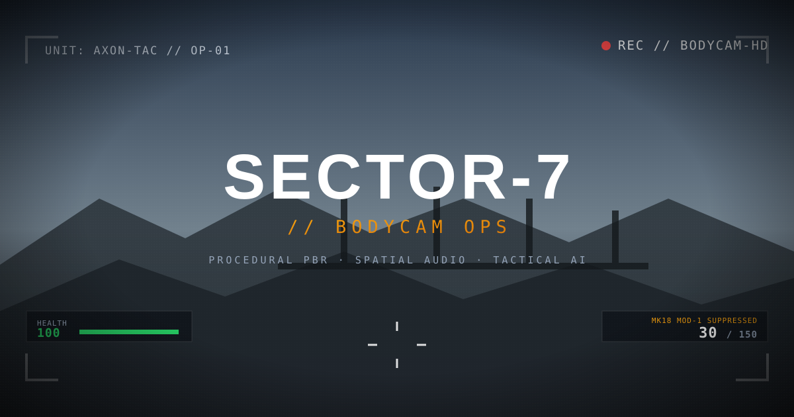

# SECTOR-7 // BODYCAM OPS

A photorealistic, fully offline tactical FPS that runs in the browser — procedural PBR
textures, spatial Web Audio, cover-based enemy AI and a bodycam post-process stack, all
generated at runtime. No art assets, no CDN, no build step.

**▶ Play: <https://amirui123.github.io/NOTIF/>**



---

## Quick start

```bash
npm start            # serves http://localhost:8080 (zero dependencies)
```

Then open <http://localhost:8080>. Any static file server works as well:

```bash
python3 -m http.server 8080
npx serve .
```

> **Why a server?** The game uses native ES modules and an import map, which browsers
> refuse to load from `file://` URLs. `npm start` starts a 60-line dependency-free server
> that binds `0.0.0.0` (so it also works inside containers and remote sandboxes).

### Requirements

|         |                                                                     |
| ------- | ------------------------------------------------------------------- |
| Browser | Chrome/Edge 111+, Firefox 108+, Safari 16.4+ (import maps + WebGL2) |
| GPU     | any WebGL2-capable adapter, hardware acceleration enabled           |
| Input   | keyboard + mouse (pointer lock); touch devices get a notice         |
| Network | none after the first load — three.js is vendored locally            |

---

## Controls

| Action                  | Key                      |
| ----------------------- | ------------------------ |
| Move / sprint           | `W A S D` / `Shift`      |
| Crouch (toggle)         | `C` or `Ctrl`            |
| Lean left / right       | `Q` / `E`                |
| Jump                    | `Space`                  |
| Fire / aim              | `LMB` / `RMB`            |
| Reload                  | `R`                      |
| Swap primary ↔ sidearm  | `1` / `2` or mouse wheel |
| Frag grenade            | `G`                      |
| Melee                   | `X`                      |
| Weapon light / laser    | `L` / `T`                |
| Night vision            | `N`                      |
| Inspect weapon          | `F`                      |
| Bodycam overlay         | `B`                      |
| Mute audio              | `M`                      |
| Pause / operator select | `Esc` or `P`             |

---

## Features

- **Five operators** with distinct loadouts (MK18, HK416A5, Kar98k, MP7A2, M249) plus a P226
  sidearm, each with its own recoil, spread, optic and reload animation.
- **Six enemy archetypes** — rifleman, veiled spectre, urban ghost (flanker), alpine marksman
  (with a scope glint telegraph), ronin enforcer and armoured juggernaut.
- **Tactical AI** — line-of-sight checks, cover seeking, peeking, flanking, burst fire,
  radio chatter and smoke-covered spawns.
- **Procedural everything** — albedo/normal/roughness maps are FBM noise baked into canvases
  at boot; all gunshots, footsteps, foleys and explosions are synthesised with Web Audio.
- **Bodycam post FX** — lens warp, chromatic aberration, sensor grain, three weather presets,
  NVG phosphor mode, damage vignette and directional hit indicator.
- **Destructible barrels**, pooled tracers/casings/blood/smoke, pickups and a wave director
  with resupply between waves.
- **Quality presets** (Ultra / High / Performance) that scale pixel ratio, shadow map size
  and bloom, plus persisted settings in `localStorage`.

---

## Project layout

```
index.html                 shell: semantic markup + import map
styles/main.css            HUD / menu styling (design tokens, reduced-motion support)
src/
  main.js                  boot sequence, WebGL probe, progress reporting
  game.js                  orchestrator: renderer, composer, waves, frame loop
  config.js                weapon / operator / enemy data (pure, unit tested)
  core/
    math.js                clamp/lerp/damp/angle/compass/collision helpers
    input.js               keyboard + pointer lock + wheel, auto-repeat safe
    dom.js                 cached lookups, safe text writes
    storage.js             fail-safe localStorage wrapper
    errors.js              fatal error surface + global handlers
  engine/
    textures.js            procedural PBR texture factory + reticles
    audio.js               procedural Web Audio engine (voice-capped)
    shaders.js             bodycam post shader + procedural sky dome
  world/
    level.js               map geometry, colliders, floors, barrels, props
    viewmodel.js           first-person weapon rig builder
    enemy.js               enemy rigs, hitboxes, tactical AI
    fx.js                  pooled casings/tracers/particles/grenades/pickups
  player/
    player.js              movement, collision, camera, vitals
    weapon.js              firing, reload/bolt/melee state machine, viewmodel animation
  ui/
    hud.js                 change-only DOM updates
    menu.js                operator select + settings
vendor/three/              three.js r170 (MIT), vendored for offline use
scripts/
  serve.js                 dependency-free static server
  build.js                 optional dist/ copy (GitHub Pages serves the root)
  patch-three-for-tests.js GPU-free three build used by the integration tests
test/
  unit/                    pure logic tests (math, textures, config)
  integration/             full game booted in jsdom with the real scene graph
  scripts/                 dev-server contract tests
.github/workflows/         CI (lint + tests) and Pages deployment
```

---

## Quality gates

```bash
npm run lint          # ESLint 9 flat config, zero warnings allowed
npm test              # 119 unit + integration tests (node:test)
npm run check         # lint + test, the same command CI runs
npm run format        # Prettier (write)
npm run format:check  # Prettier (verify, used by CI)
```

The integration suite boots the **real** `Game` class inside jsdom against the vendored
three.js build; only `WebGLRenderer`/`PMREMGenerator` are stubbed. It drives the actual frame
loop and asserts on deploy flow, movement/collision, sprint/crouch, hitscan damage, the
once-only reload transfer, the wave director, pause/resume, grenade damage and the game-over
summary. This is how the bugs listed in [`FIXES.md`](FIXES.md) were caught and are now
prevented from regressing.

| Suite                                     | Tests | Covers                                                    |
| ----------------------------------------- | ----- | --------------------------------------------------------- |
| `test/unit/math.test.js`                  | 12    | clamp, lerp, damp, angle wrapping, compass, circle-vs-box |
| `test/unit/textures.test.js`              | 4     | procedural noise ranges and surface recipes               |
| `test/unit/config.test.js`                | 4     | loadout/weapon/enemy data invariants                      |
| `test/unit/input.test.js`                 | 6     | pointer-lock fallback, wheel debounce, auto-repeat        |
| `test/unit/weapon.test.js`                | 11    | fire cadence, once-only reload, semi-auto, bolt cycle     |
| `test/unit/player.test.js`                | 10    | movement, collision, headroom, armour/damage              |
| `test/unit/compass.test.js`               | 4     | tick spacing, label order, scroll calibration             |
| `test/integration/game.smoke.test.js`     | 14    | full boot → deploy → combat → game over                   |
| `test/integration/input-wiring.test.js`   | 7     | real DOM events for look/fire/ADS/wheel/pause             |
| `test/integration/hitscan.test.js`        | 4     | hitbox parenting, 8 m hit rate, headshots                 |
| `test/integration/collision.test.js`      | 5     | spawn, walkability, map bounds, overhead geometry         |
| `test/integration/enemy-path.test.js`     | 3     | pathing past cover, bounds, long-engagement sanity        |
| `test/integration/scene-lighting.test.js` | 6     | camera graph, per-preset fill, idle flash, NaN scan       |
| `test/integration/laser.test.js`          | 4     | default off, beam length, stale geometry, world dot       |
| `test/integration/pickups.test.js`        | 6     | heal caps, ammo refill, barrels, blast falloff            |
| `test/integration/grenade.test.js`        | 3     | frag damage, player blast, inventory                      |
| `test/integration/ui.test.js`             | 9     | modal semantics, focus trap, HUD diffing, clock           |
| `test/scripts/serve.test.js`              | 7     | dev-server MIME types, 404s, traversal                    |

---

## Deploying

GitHub Pages serves the repository root (no build required). Pushing to `main` triggers
`.github/workflows/pages.yml`, which publishes the site via the official Pages actions.

Any other static host works too — Netlify, Cloudflare Pages, S3, `npx serve .`. Just make
sure `.js` files are served as `text/javascript`.

---

## License

MIT — see [`LICENSE`](LICENSE). three.js is © three.js authors, also MIT; its license is
included at [`vendor/three/LICENSE`](vendor/three/LICENSE).
